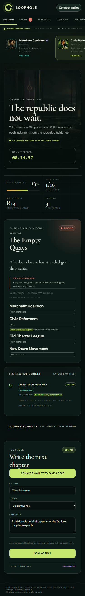

# Building binding precedent on GenLayer: quote-verified judgments and finality callbacks

Loophole V7 treats a court decision as reusable game state. A player does not ask an open-ended model to choose a penalty. Instead, the case is tied to one law version and one action already recorded by the republic. The court derives a key from those facts, asks validators one bounded question for a novel key, checks the selected quote against frozen law text, and lets deterministic code derive the result. After native finality, later cases with the same key are resolved from the holding registry without another model call.

## Start with evidence the contract owns

The Court obtains the action and effective law from the republic rather than trusting a plaintiff to describe them. The rule is narrow by construction: the action round, law ID, action type, and target class become part of the case evidence. `_target_class` maps the target into one of the contract's fixed classes, and the holding key is the exact tuple `law_id|action_type|target_class`. A new amendment has a new law ID, so its scope cannot silently rewrite an older holding.

The court preserves the original evidence JSON and digest. That helps a reviewer compare a case to the action the contract actually recorded. User claims remain arguments; they do not select the target class or sanction. Prompt injection therefore cannot change the frozen action. A hostile claim may still be read as untrusted input, but validators must return a member of the fixed label set and quote words from the cited law.

The registry key is intentionally plain and deterministic. This excerpt is from `contracts/CaseLaw.py`:

```python
def _holding_key(law_id: int, action_type: str, target_class: str) -> str:
    return f"{law_id}|{action_type}|{target_class}"
```

## Ask for a label and exact words

For a first impression, the semantic judgment returns one label and a verbatim quote. The allowed labels are `COVERED_BREACH`, `COVERED_COMPLIANT`, `NOT_COVERED`, and `UNCLEAR`. Validators must agree exactly on the label. The contract checks the quote against its frozen law text, then maps the label to a disposition and any sanction. An unsupported label, mismatching quote, disagreement, oversized input, or deadline expiry fails closed.

The quote is useful to people reviewing the case. It points to the words that were interpreted, while the holding key describes the narrow type of situation to which the interpretation applies. For example, a holding for law 2, `UNDERMINE`, and `OTHER_FACTION` does not decide a different law version or an `OFFICEHOLDER` target. The interface highlights the quote inside the law text; if the original text is no longer retained, it shows the preserved quote and identifies the missing source text.

## Reuse the holding instead of asking again

CaseLaw is separate from the court so another GenLayer court could use the same registry pattern. Its `record_holding` entrypoint accepts writes only from the linked court, and recording the same content twice is idempotent. A different result for an existing key is rejected. The read methods expose a single holding, a holding by its origin case, a bounded set of holdings for law IDs, and registry counts.

When a case is filed, the court first checks the registry. If a holding already exists for the key, `_decide_summary` copies its label, quote, and origin case ID and derives the result in ordinary contract code. This route does not call an LLM. If no holding exists but another case is already deciding that key, the new case waits in `STAYED`. Only one first impression can decide a key at a time. A safe harbor (`NOT_COVERED`) is as binding as a breach: later matching actions remain uncovered until the legislature creates a new law version.

## Wait for finality before publishing consequences

A validator's initial answer is not yet a permanent holding. Loophole emits the registry write and republic outcome for GenLayer's finalized callback. This aligns public precedent and numeric consequences with the accepted result after the native appeal window. The court records a ruling digest and emits the holding only for labels that create precedent. `UNCLEAR` produces no holding. A summary follows the existing holding and does not create a second one.

Callbacks may fail to land even after the court transaction finalizes. The case therefore carries effect-pending state, and permissionless recovery can re-emit missing effects. Both destinations deduplicate by key or case/action so retrying does not double-apply a sanction. A stayed case checks the holding again when recovered; if the first case ended without a holding, the waiting case can become the new decider. Finite brief, resolution, and recovery deadlines keep incomplete work from blocking the docket forever.

The callback boundary is explicit in `contracts/RepublicCourt.py`:

```python
def _emit_holding(self, case: CourtCase) -> None:
    if case.label == LABEL_UNCLEAR:
        return
    gl.get_contract_at(self.caselaw_address).emit(on="finalized").record_holding(
        case.key, int(case.law_id), json.loads(case.evidence_json)["action"]["action_type"],
        case.target_class, case.label, case.quote, int(case.case_id), case.ruling_digest,
    )
```

## Read and verify the result

Open the Docket to see current cases and the Case Law page to browse holdings by law version. Each entry shows the frozen action, target class, label, exact quote, and holding key. When the live proof manifest is present, filing and ruling links are mapped by case ID from `deploy/proof.json`; these are historical transactions, distinct from current live contract reads. The mobile screenshot in [the Phase 4 report](v7/reports/phase4-mobile.png) records the narrow-screen Docket layout. Local tests verify contract invariants and GLSim can exercise callback flows, but neither is a substitute for checking finalized transactions on StudioNet.

The useful general pattern is simple: derive the question from contract-owned facts, ask validators for a small semantic result, verify the words that support it, and let deterministic code own every consequence. Keep evidence bounded, make keys explicit, and put permanent state changes behind finality. Those boundaries make precedent inspectable and reusable without asking a model to calculate the game.


